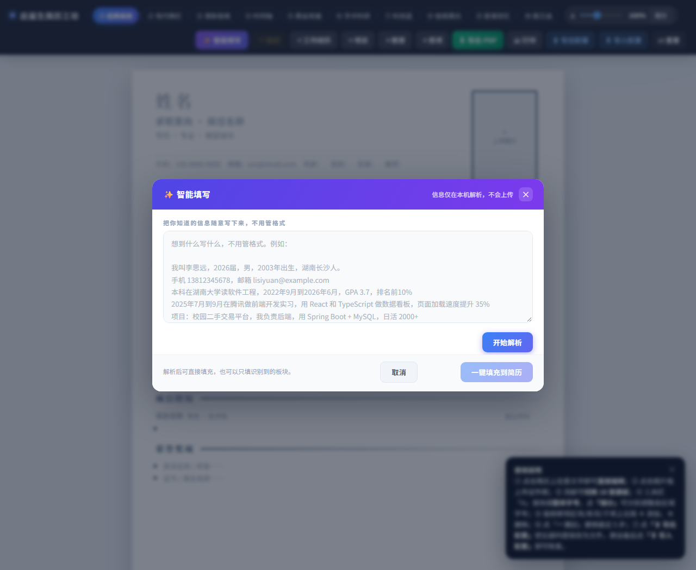

# 简历智能填写

一个双击就能用的简历编辑器。把一段随手的自我介绍丢进去，AI 自动拆成教育、实习、项目、
技能、奖项，填进对应板块。

支持 10 套模板、证件照、撤销重做、一键导出 A4 PDF。



> ### ⚠️ 使用前需要你自己的 API Key
>
> 本项目**不包含任何密钥**。你需要到 <https://platform.deepseek.com> 申请一个，
> 填进 `.env` 文件里（第 2 步会讲），大约一分钟。
>
> 不配也能打开页面，但「AI 智能填写」用不了。

## 三步跑起来

### 1. 装 Node.js

到 <https://nodejs.org> 下载 **18 或更高版本**，一路「下一步」装完即可。

### 2. 填自己的 Key

在项目文件夹里，把 `.env.example` 复制一份、改名成 `.env`：

```bash
# Windows（cmd / PowerShell）
copy .env.example .env

# macOS / Linux
cp .env.example .env
```

不想敲命令也行：在文件管理器里右键 `.env.example` → 复制 → 粘贴 → 重命名成 `.env`
（前面的点不能丢，Windows 提示「确实要更改扩展名吗」时选「是」）。

然后用记事本打开 `.env`，把这一行换成你自己的密钥：

```ini
DEEPSEEK_API_KEY=sk-你的密钥
```

### 3. 启动

1. 双击 `start.bat`，会弹出一个黑色窗口 —— **这个窗口不要关**，关了服务就停了
2. 双击 `简历填写主页面.html`，用浏览器打开

看到 `DEEPSEEK_API_KEY 已就绪` 就说明成功了。

## 怎么用

### 手动填写

点简历上任意文字就能直接改。鼠标移到条目上会出现「＋」（加一行）和「×」（删掉这条）。

### 用 AI 自动填

1. 点右上角「✨ 智能填写」
2. 把自我介绍粘进去，口语化也行，不用整理格式
3. 点「开始解析」，几秒后出现预览
4. 确认内容无误，点「填充到简历」

几个要注意的地方：

- 默认是**「只补不删」**：只填空着的位置，你已经写好的内容一个字都不会动
- 想让 AI 整段重写，勾上「覆盖板块已有内容」
- 如果预览里有「未能归类」的行，可以手动复制到合适的板块

### 换模板、调字号

顶部有 10 套模板，点一下就切换，内容不会丢。

右下角的字号滑块可以整体放大 / 缩小。内容超出一页时，底部会弹出提示，点「压缩到一页」会自动调到刚好装下。

### 导出 PDF

点右上角「⬇ 导出 PDF」，文件名会自动用简历里的姓名（比如「张三的简历.pdf」）。

也可以用「打印」，在弹出的打印窗口里选「另存为 PDF」。

> PDF 只输出第 1 页。如果内容超出一页，会先提醒你压缩或精简。

### 备份与换电脑

点「⬆ 导出配置」，会把当前简历（含证件照）存成一个 `.json` 文件。

换电脑后在新的页面里点「导入配置」，选这个文件就能恢复。

## 你的数据在哪

这部分值得花一分钟看一下：

- **简历内容保存在你自己电脑的浏览器里**，不会自动上传到任何服务器
- 只有你点「智能填写」时，**你粘贴的那段文字**才会发给 DeepSeek 用于解析
- **导出的配置文件里是完整个人信息（含证件照）**，发给别人前先想清楚
- 密钥只存在你电脑的 `.env` 里，网页和网络请求里都不会出现它
- 清理浏览器缓存、换浏览器、用无痕模式，都会导致内容丢失 —— 重要内容记得导出备份

## 常见问题

**提示「连接不上解析服务」**
`start.bat` 那个窗口没开，或者已经被关了。重新双击它，保持窗口打开。

**提示「端口 3000 已被占用」**
上一次启动的窗口还开着。关掉旧窗口再启动，就这么简单。

**想换一个端口**
在命令行里先执行 `set PORT=3001`，再执行 `node server.js`。
然后点页面标题 5 次打开设置面板，把服务地址改成 `http://127.0.0.1:3001`。

**提示密钥无效 / 解析失败**
检查 `.env` 里的 `DEEPSEEK_API_KEY` 是不是你自己的、有没有多余空格，以及账户是否还有余额。

**导出 PDF 只有第一页**
内容超出一页了。点右下角「压缩到一页」，或者删减部分描述。

**换电脑后内容没了**
数据存在浏览器本地，不会跟着账号走。用「导出配置」备份、「导入配置」恢复。

**想改服务地址或模型**
连点标题「✨ 智能填写」5 次，或按 `Ctrl + Shift + ,` 打开设置面板。

## 给开发者

要改代码、部署到服务器，或者想了解内部实现（接口、环境变量、测试、结构适配层），
见 [docs/DEVELOPING.md](docs/DEVELOPING.md)。

## 许可证

MIT
